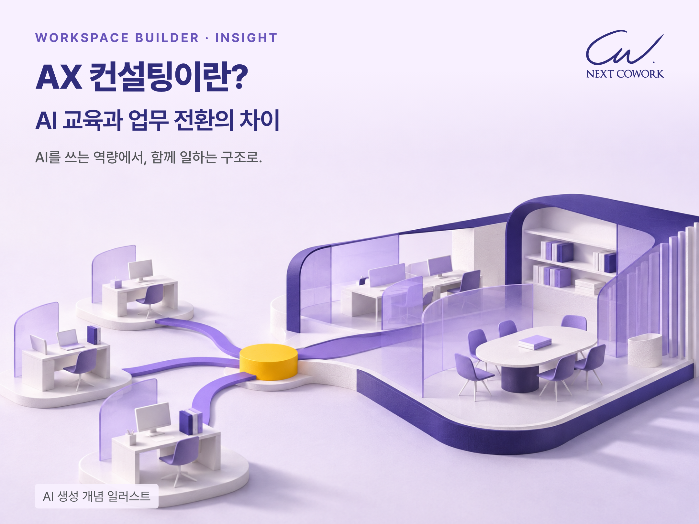
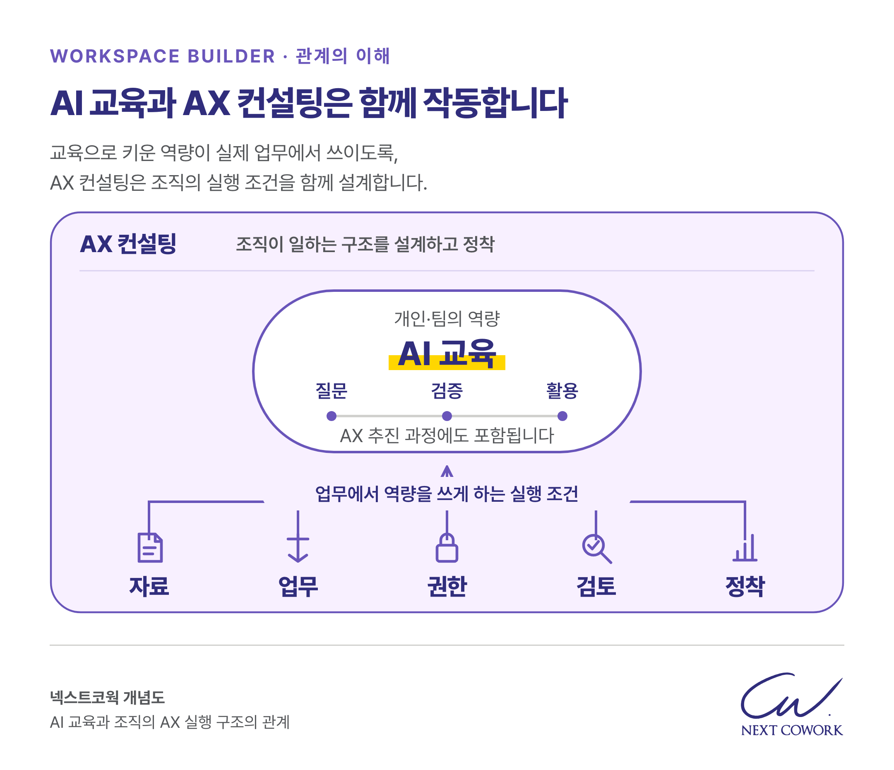
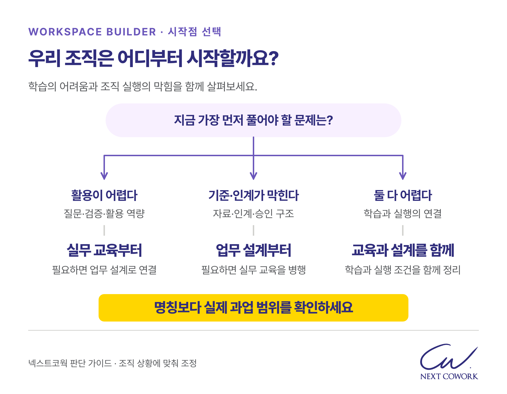
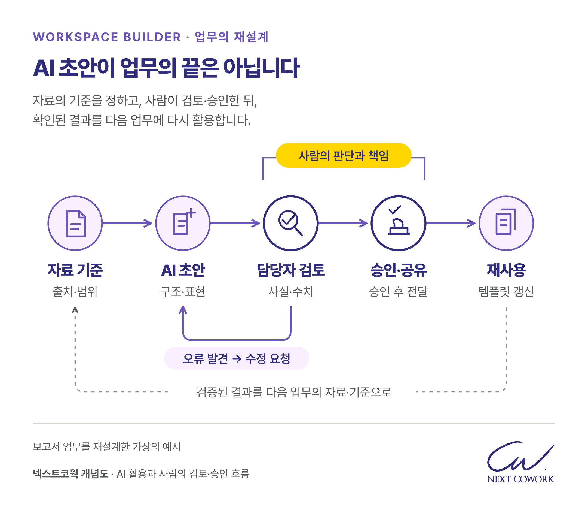
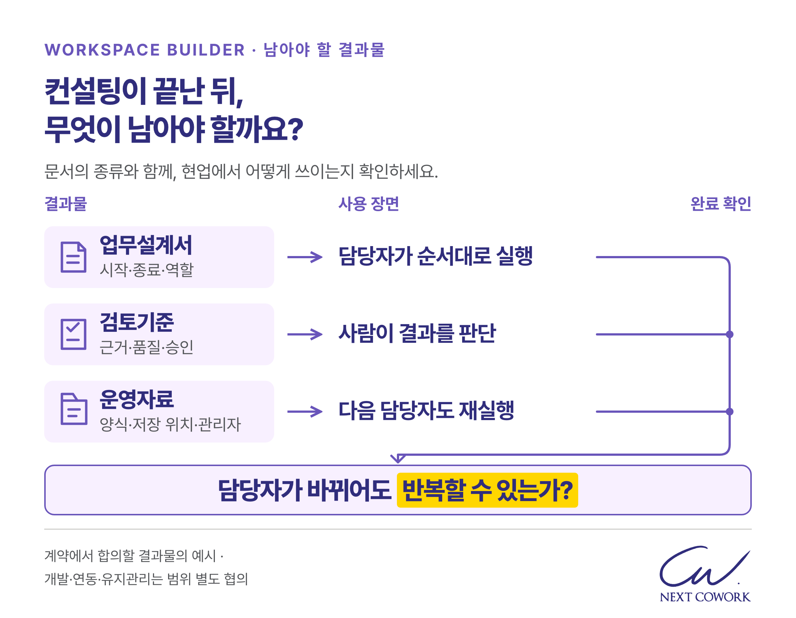
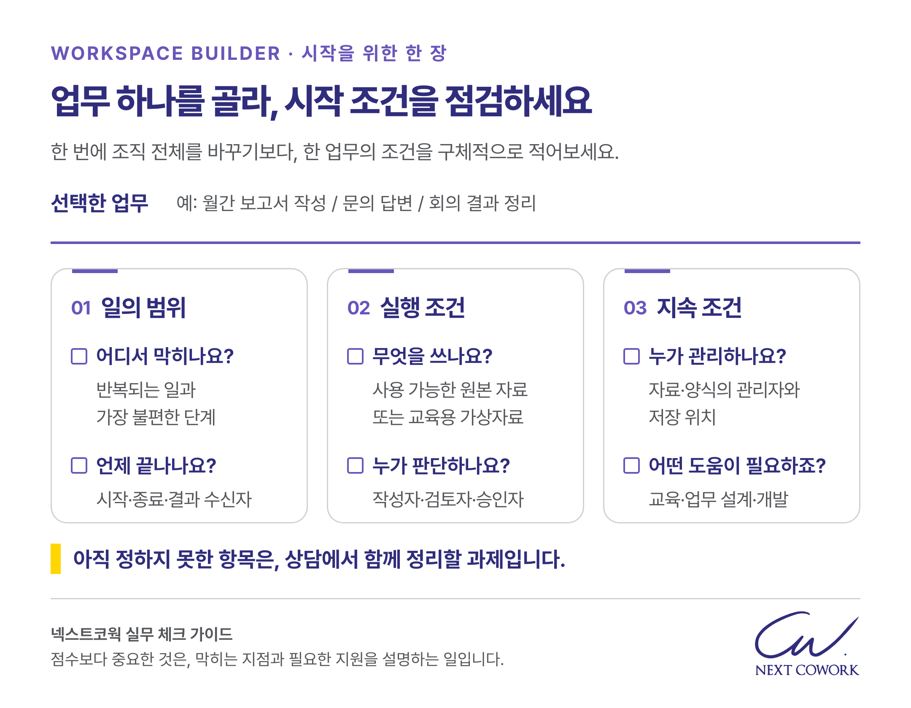

AX 컨설팅은 AI를 활용해 조직의 업무 흐름과 책임, 실행 기준을 함께 설계하는 일입니다. AI 교육과의 차이는 도구의 난도가 아니라 어디까지 바꾸려는지에 있습니다. 교육을 통해 배운 방법이 현업에서 이어지려면 무엇이 필요한지, 보고서 작성 흐름을 따라 살펴보겠습니다.

## AX 컨설팅은 무엇을 바꾸는 일인가요?

AX는 AI 전환을 뜻하며, 업무를 수행하는 사람과 자료, 판단 절차를 함께 바꾸는 관점으로 접근해야 합니다. 어떤 도구를 쓸지에 더해 누가 자료를 준비하고, 무엇을 AI에 맡기며, 결과를 누가 확인할지 정하는 일입니다.

예를 들어 보고서 초안은 빨리 나오는데 결재까지 걸리는 시간은 그대로일 수 있습니다. 원본 자료가 흩어져 있거나 검토 기준이 불분명하면 작성 속도만 높여도 전체 업무는 원활해지지 않습니다. 이때 필요한 것은 더 긴 프롬프트보다 자료의 기준과 역할, 승인 흐름을 정리하는 일입니다.

어떤 업무를 먼저 바꿀지는 반복성뿐 아니라 책임자와 검토 기준의 준비 상태까지 보고 판단해야 합니다.

### AI 교육과 AX 컨설팅은 어떻게 연결되나요?

AI 교육과 AX 컨설팅은 경쟁하는 선택지가 아니라 서로 보완하는 활동입니다. 교육은 참여자가 업무에 맞게 AI를 활용하고 결과를 검토하는 능력을 기릅니다. 실무 교육은 자료 정리부터 검수와 재사용까지 업무 흐름을 다루고, 현업 적용과 후속 정착을 지원할 수도 있습니다. 서비스 이름만으로 범위를 단정해서는 안 됩니다.

AX 컨설팅은 조직의 일상 업무를 운영할 조건을 중심으로 범위를 잡습니다. 여러 부서가 같은 원본을 쓰는지, 자료 접근 권한은 적절한지, 최종 승인자는 누구인지, 담당자가 바뀌어도 같은 절차를 반복할 수 있는지를 함께 설계합니다. **개인의 실행 능력과 조직의 실행 체계를 어느 범위까지 다룰지가 핵심 차이입니다.**

직원이 자료를 읽고 요청문을 쓰는 데 어려움이 있다면 교육이 우선일 수 있습니다. 이미 결과물을 만들지만 부서마다 기준이 달라 인계가 막힌다면 업무 설계가 필요합니다. 두 문제가 함께 있다면 업무를 정리하면서 필요한 교육을 연결하십시오.

## 보고서 작성 업무는 구체적으로 어떻게 바뀌나요?

보고서 작성에서는 자료부터 재사용까지 연결하고, 단계마다 사람이 확인할 기준을 정해야 합니다. 이해를 돕기 위해 기관의 월간 사업 보고서를 작성하는 가상 상황을 살펴보겠습니다.

**자료 준비:** 담당자가 사용할 문서의 기준일과 원본을 확인합니다. 이전 계획과 변경 계획을 구분하고, AI에 입력할 수 있는 범위와 도구를 조직 기준에 맞춰 정합니다. 이름을 지운 자료라고 해서 자유롭게 입력할 수 있다고 가정해서는 안 됩니다.

**AI 초안:** 확인된 자료를 바탕으로 추진 현황, 주요 쟁점, 결정할 사항을 정리하게 합니다. 자료에 없는 성과나 원인은 만들지 않도록 하고, 사실과 담당자의 해석을 구분합니다. 근거가 부족한 항목은 확인할 질문으로 남깁니다.

**담당자 검토:** 작성자가 숫자와 단위, 적용 기간, 고유명사, 결론의 근거를 원문과 대조합니다. AI의 자체 확인과 별개로 실제 사용 목적에 맞는지 사람이 판단해야 합니다.

**승인과 공유:** 검토된 초안을 승인자가 확인한 뒤 정해진 대상에게 공유합니다. 초안 생성 권한과 실제 발송 권한은 구분합니다. 예외 상황의 확인 담당자도 정합니다.

**재사용:** 최종 보고서와 함께 사용한 자료, 작성 조건, 검토 항목을 관리합니다. 다음 담당자도 새 자료로 같은 절차를 실행할 수 있어야 합니다.

교육에서도 이 흐름을 실습할 수 있습니다. 조직의 역할과 권한, 저장 위치, 예외 처리까지 다룰지는 과업의 완료 범위로 확인해야 합니다.

## 제안서에서는 어떤 결과물을 확인해야 하나요?

제안서에서는 실행 후 남을 결과물과 완료 조건을 확인해야 합니다. 업무 흐름, 역할 분담, 자료 준비 조건, 검토 기준 중 무엇을 정리하는지 물어보십시오.

업무 설계와 개발도 구분해야 합니다. 컨설팅을 계약했다고 모든 시스템 개발과 자동화 구축, 운영 지원이 포함되는 것은 아닙니다. 도구 설정, 기존 시스템 연동, 프로그램 개발과 유지관리는 필요한 범위를 별도로 협의해야 합니다.

시범 적용에서는 기존 방식과 새 방식을 같은 조건에서 비교합니다. 초안 작성 시간만 보지 말고 자료 준비와 검수 부담, 결과 품질, 다른 담당자의 반복 실행 가능성까지 확인해야 합니다. 잘된 시연 하나보다 현업에서 계속 사용할 조건이 갖춰졌는지가 확대 판단의 근거입니다.

## 우리 조직은 무엇부터 준비하면 좋을까요?

바꾸고 싶은 업무 하나를 고르고 다음 항목을 적어보십시오. 교육과 조직 차원의 정리가 필요한 지점을 구분할 수 있습니다.

- □ 반복되는 업무와 현재 가장 불편한 단계를 적었습니다.
- □ 업무의 시작과 종료, 결과물을 받는 사람을 설명할 수 있습니다.
- □ 사용 범위를 확인한 공개자료나 교육용 가상자료를 준비할 수 있습니다.
- □ 작성자, 검토자, 최종 승인자의 역할을 구분할 수 있습니다.
- □ 담당자가 바뀌어도 사용할 자료와 양식의 관리자를 정할 수 있습니다.
- □ 교육, 업무 설계, 개발 중 필요한 지원 범위를 논의했습니다.

활용 역량을 높이는 과제는 [넥스트코웍 AI Campus](https://www.nextcw.com/ai-campus/)의 교육 범위와 함께 살펴볼 수 있습니다. 부서 간 인계와 승인, 자료 관리가 문제라면 그 흐름을 상담에서 설명해 주십시오. Workspace Builder의 관점은 사람이 배운 방법이 조직의 실제 일로 이어지는 조건을 찾는 데 있습니다.

## 자주 묻는 질문

### 1. AI를 잘 모르는 조직도 AX 컨설팅을 시작할 수 있나요?

가능합니다. 업무의 문제와 자료 상태를 먼저 확인하고, 실행에 필요한 기초 교육을 함께 설계할 수 있습니다. 다만 내부에서 업무를 설명하고 결과를 판단할 담당자는 필요합니다.

### 2. AI 교육을 받으면 AX가 끝난 것인가요?

교육은 중요한 기반이지만 조직 전체의 적용 완료를 뜻하지는 않습니다. 학습한 방법이 실제 업무에서 쓰이는지, 검토와 승인 책임이 정해졌는지, 자료와 양식이 관리되는지 확인해야 합니다.

### 3. 처음부터 전사 자동화를 추진해야 하나요?

그럴 필요는 없습니다. 책임자와 검토 기준이 분명한 업무에서 적용 조건을 확인한 뒤 확대할 수 있습니다. 자동화 개발이 필요한지는 업무 설계와 함께 별도로 판단하십시오.

## 우리 조직에 맞는 AX는 어떻게 시작할까요?

우리 조직에 필요한 교육과 업무 전환의 범위를 정리하고 싶으시다면 [넥스트코웍 상담을 신청해 주세요](https://www.nextcw.com/contact/). 현재 반복하는 업무와 막히는 지점을 남겨주시면, 일이 잘되는 방법을 만들기 위한 과제와 지원 범위를 함께 살펴보겠습니다.

