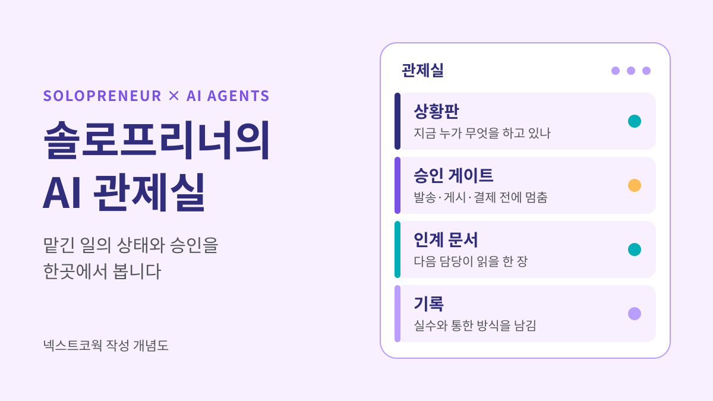
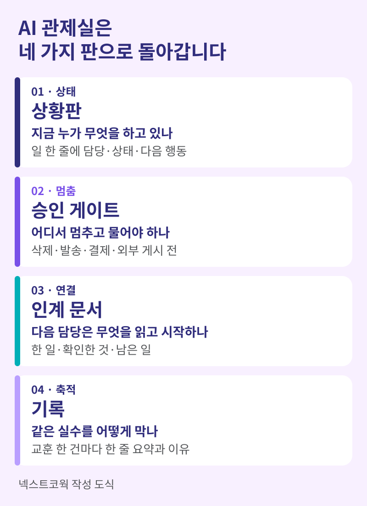
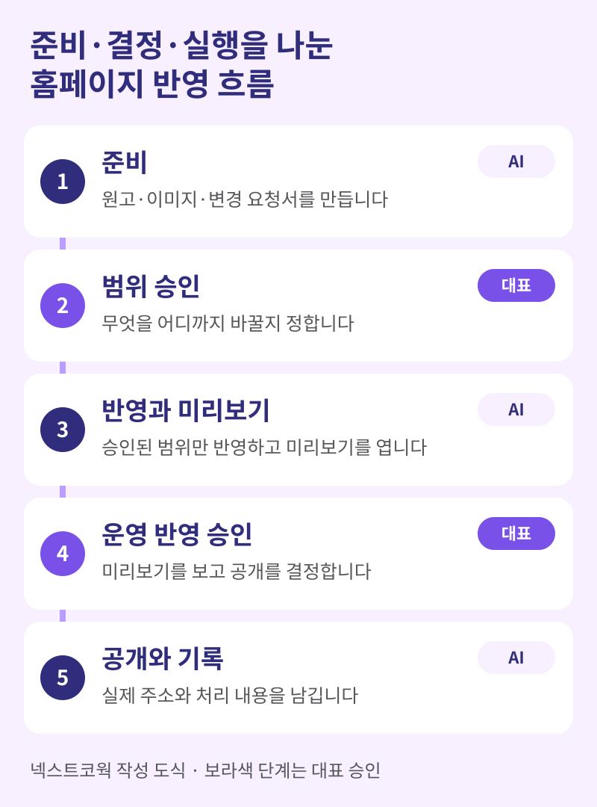

솔로프리너의 AI 관제실은 여러 AI에게 맡긴 일의 상태와 승인 지점을 한곳에서 보는 운영 방식입니다. 새로 사야 하는 도구의 이름이 아니라, 일을 맡기고 확인하는 자리의 배치입니다. 필요한 것은 상황판, 승인 게이트, 인계 문서, 기록 네 가지입니다.

저는 넥스트코웍에서 공간 컨설팅, AI 교육, AX 컨설팅을 함께 운영하는 솔로프리너입니다. AI에게 맡기는 일이 늘어나면서 알게 된 것이 있습니다. 제 시간을 가장 많이 잡아먹는 것은 작업이 아니라 확인을 기다리는 시간과 같은 설명의 반복이었습니다.

이 글은 같은 지점에 선 1인 기업가와 작은 조직의 대표를 위해 썼습니다. 끝까지 읽으면 관제실 네 가지 판의 요약표, 복사해 쓸 상황판과 인계 문서 양식, AI에게 줄 멈춤 지침 문구를 가져갈 수 있습니다.



## 솔로프리너에게 왜 AI 관제실이 필요할까요?

AI에게 맡기는 일이 늘수록 병목이 작업에서 대표의 확인으로 옮겨 가기 때문입니다.

월요일 아침을 가정해 봅시다. 한 AI에는 제안서 초안을, 다른 AI에는 블로그 원고를, 또 다른 AI에는 홈페이지 수정을 맡겼습니다. 점심 무렵이면 세 창 모두 무언가를 끝내고 기다립니다. 그런데 어느 창이 무엇을 기다리는지, 어디까지 확인했는지는 대표의 머릿속에만 있습니다. 창을 다시 열 때마다 배경을 다시 설명하게 되고, 승인 한 번을 받지 못한 일이 반나절씩 멈춥니다.

직원이 있는 회사라면 팀장과 주간 회의가 이 역할을 나눠 맡습니다. 솔로프리너에게는 그 자리가 없습니다. 그래서 따로 만들어야 합니다.

건설 현장의 PM은 직접 철근을 묶지 않습니다. 공정표로 순서를 보고, 검측으로 다음 공정에 넘어가도 되는지를 판단합니다. 공항의 관제사도 비행기를 조종하지 않고 순서와 이착륙 허가를 관리합니다. 저는 건설 PM으로 일하며 이 방식을 익혔고, AI에게 일을 맡길 때도 같은 자리가 필요하다는 것을 알게 됐습니다.

| 구분 | 채팅창을 여러 개 띄운 방식 | 관제실 방식 |
|---|---|---|
| 일의 상태 | 대표의 기억에 있다 | 상황판 한 장에 있다 |
| 멈추는 지점 | 그때그때 판단한다 | 미리 적어 둔 승인 게이트에서 멈춘다 |
| 일의 연결 | 창마다 배경을 다시 설명한다 | 인계 문서를 읽고 시작한다 |
| 실수 이후 | 같은 지적을 반복한다 | 기록에 남기고 다음 일에 적용한다 |

## AI 관제실은 무엇으로 이루어지나요?

AI 관제실은 상황판, 승인 게이트, 인계 문서, 기록의 네 가지 판으로 이루어집니다. 각 판은 대표가 하루에도 몇 번씩 스스로에게 묻는 질문 하나에 답합니다.



| 판 | 답하는 질문 | 가장 작은 형태 |
|---|---|---|
| 상황판 | 지금 누가 무엇을 하고 있나 | 일 한 줄에 담당, 상태, 다음 행동을 적은 표 |
| 승인 게이트 | 어디서 멈추고 물어야 하나 | AI 지침 맨 위에 적은 멈춤 조건 세 줄 |
| 인계 문서 | 다음 담당은 무엇을 읽고 시작하나 | 한 일, 확인한 것, 남은 일을 적은 한 장 |
| 기록 | 같은 실수를 어떻게 막나 | 교훈 한 건마다 한 줄 요약과 이유 |

네 가지 모두 메모 앱이나 폴더 하나로 시작할 수 있습니다. 중요한 것은 화면의 모양이 아니라 AI와 대표가 같은 문서를 본다는 점입니다. 상태가 대표의 머릿속에만 있으면 AI는 매번 처음부터 묻습니다. 문서에 있으면 읽고 이어서 일합니다.

이 네 가지는 사람과 AI가 함께 일하는 조건을 다룬 [COWORK 여섯 가지 조건](/insights/ai-cowork-six-conditions/) 가운데 일할 자리, 조율, 기록에 해당합니다. 조직의 조건을 한 사람의 책상 크기로 줄인 것이 관제실입니다.

## 무엇을 AI에게 맡기고 무엇을 직접 승인해야 할까요?

되돌릴 수 있는 일은 묻지 않고 진행하게 하고, 되돌릴 수 없는 일은 대표가 승인합니다. 기준을 "중요한 일인가"로 잡으면 모든 일이 중요해 보여서 승인이 쌓입니다. "되돌릴 수 있는가"로 잡으면 선이 분명해집니다.

제가 AI에게 준 지침에는 멈추고 물어야 하는 경우가 세 가지로 적혀 있습니다.

- 되돌릴 수 없는 작업일 때: 삭제, 발송, 결제, 외부 게시
- 요청한 범위가 실질적으로 바뀔 때
- 대표만 줄 수 있는 정보가 필요할 때

그 밖의 일은 묻지 않고 끝까지 진행하게 합니다.

| 일의 종류 | 예 | 처리 |
|---|---|---|
| 되돌릴 수 있는 일 | 초안 작성, 자료 정리, 내부 문서 수정, 미리보기 만들기 | AI가 끝까지 진행 |
| 되돌릴 수 없는 일 | 고객 메일 발송, 홈페이지 공개, 결제, 파일 삭제 | 대표 승인 뒤 진행 |
| 범위가 바뀌는 일 | 글 한 편 요청이 사이트 구조 변경으로 커질 때 | 멈추고 질문 |
| 대표만 아는 정보 | 가격, 실적 수치, 고객과 한 약속 | 멈추고 질문 |

승인 게이트는 AI를 믿지 못해서 두는 장치가 아닙니다. 승인할 일의 수를 줄여서, 남은 승인에 집중하기 위한 장치입니다.

아래 문구를 사용하는 AI 도구의 지침 맨 위에 붙여 넣고, 자신의 업무에 맞게 고쳐 보세요.

```text
실행할 정보가 충분하면 바로 진행합니다.
아래 세 가지 경우에만 멈추고 저에게 묻습니다.
1. 되돌릴 수 없는 작업: 삭제, 발송, 결제, 외부 게시
2. 요청한 범위가 실질적으로 바뀌는 경우
3. 저만 줄 수 있는 정보가 필요한 경우
보고할 때는 직접 확인한 것과 확인하지 못한 것을 구분합니다.
```

## 넥스트코웍은 홈페이지를 어떻게 관제하나요?

넥스트코웍 홈페이지는 준비, 결정, 실행을 서로 다른 자리로 나누고, 공개 전에 대표 승인을 두 번 거칩니다. 작은 회사의 홈페이지이지만 관제실의 네 가지 판이 모두 들어 있습니다.



- 준비를 맡은 AI는 원고, 이미지, 변경 요청서를 만듭니다. 사이트 파일은 고치지 않습니다.
- 대표는 요청서를 보고 무엇을 어디까지 바꿀지 승인합니다.
- 실행을 맡은 AI는 승인된 범위만 사이트에 반영하고 미리보기를 엽니다.
- 대표는 미리보기를 확인하고, 운영 반영을 따로 승인합니다.
- 공개가 끝나면 실제 주소와 처리 내용을 요청서에 남깁니다.

규칙도 문서에 적어 둡니다. 예를 들어 지침에는 "원고 초안 요청을 사이트 변경이나 배포 승인으로 해석하지 않는다"는 문장이 있습니다. 준비하는 자리와 실행하는 자리가 같은 파일을 동시에 고치지 않게 나눈 것도 같은 이유입니다.

기록도 실제로 일을 줄여 줍니다. 한번은 AI가 다른 프로젝트의 화면을 열어 놓고 우리 사이트라고 보고한 적이 있습니다. 그날 "주소가 열리는지만 보지 말고 페이지 제목으로 확인한다"는 한 줄이 교훈 기록에 추가됐습니다. 이후의 작업은 그 한 줄을 읽고 시작합니다.

이 글도 같은 흐름으로 나왔습니다. 초안과 미리보기까지는 AI가 만들었고, 공개는 제가 확인한 뒤 승인했습니다.

## 관제실은 하루에 얼마나 들여다봐야 할까요?

하루 세 번, 정해 둔 시간에만 여는 것을 권합니다. 관제실을 종일 띄워 두면 AI가 일을 끝낼 때마다 주의가 끊겨서, 맡긴 보람이 줄어듭니다. 횟수보다 중요한 것은 정해 둔 시간에만 연다는 원칙입니다.

| 시점 | 하는 일 | 남기는 것 |
|---|---|---|
| 아침 | 오늘 맡길 일을 정하고 완료 기준을 적는다 | 상황판의 새 줄 |
| 점심 무렵 | 승인을 기다리는 일만 모아서 처리한다 | 승인 또는 보완 지시 |
| 퇴근 전 | 끝난 일을 확인하고 교훈을 한 줄 적는다 | 기록 한 건과 내일의 첫 일 |

상황판을 열 때는 하나만 묻습니다. "지금 나를 기다리는 일이 무엇인가?" 솔로프리너의 관제실에서 가장 비싼 상태는 진행 중이 아니라 대표 확인 대기입니다.

## 이번 주에 어떻게 시작하면 될까요?

상황판 한 장, 멈춤 조건 세 줄, 인계 문서 양식의 순서로 시작하면 됩니다. 도구를 새로 살 필요는 없습니다.

1. 지금 AI에게 맡긴 일을 모두 적어 상황판 한 장을 만듭니다.
2. 앞에서 본 멈춤 지침을 사용하는 AI 도구의 지침 칸에 붙여 넣습니다.
3. 일이 끝날 때마다 AI에게 인계 문서를 쓰게 합니다.

```text
[상황판]
일 | 담당 | 상태 | 다음 행동 | 기한
제안서 초안 | AI | 대표 확인 대기 | 가격표 확인 | 수요일
블로그 원고 | AI | 진행 중 | 초안 완성 후 보고 | 목요일
홈페이지 수정 | AI | 대표 확인 대기 | 미리보기 확인 후 공개 승인 | 금요일

상태는 네 가지만 씁니다: 진행 중, 대표 확인 대기, 보완 중, 완료

[인계 문서]
한 일:
직접 확인한 것:
확인하지 못한 것:
남은 일과 다음 담당:
```

일주일 뒤에는 대표 확인 대기에 가장 오래 머문 일을 살펴보세요. 그 일이 다음에 손볼 승인 게이트입니다. 묻지 않고 진행해도 되는 일이었다면 지침을 고치고, 꼭 물어야 하는 일이었다면 확인하는 시간을 앞당깁니다.

자신의 반복 업무에서 무엇을 맡기고 무엇을 직접 승인할지 정하는 과정은 [CEO AI 코칭](/coaching/)에서도 다루는 업무 적용의 출발점입니다.

## 자주 묻는 질문

### AI 관제실을 만들려면 전용 도구가 필요한가요?

전용 도구 없이 시작할 수 있습니다. 상황판은 표 한 장, 승인 게이트는 지침 세 줄, 인계 문서와 기록은 폴더 하나면 됩니다. 도구는 일이 늘어 표 한 장으로 감당하기 어려워졌을 때 골라도 늦지 않습니다.

### AI에게 한 번에 몇 가지 일까지 맡겨도 되나요?

대표가 하루 안에 확인할 수 있는 만큼만 맡기는 것이 기준입니다. 맡긴 일의 수보다 대표 확인 대기에 쌓인 일의 수를 보세요. 대기가 하루를 넘기기 시작하면 맡기는 일을 줄이거나, 묻지 않고 진행할 범위를 넓힐 때입니다.

### 직원이 있는 회사에도 적용할 수 있나요?

적용할 수 있습니다. 다만 사람이 여럿이면 누가 승인하고 누가 인계받는지를 먼저 정해야 합니다. 조직 단위의 조건은 [사람과 AI가 함께 일하는 6가지 조건](/insights/ai-cowork-six-conditions/)에 정리했고, 팀의 실제 업무로 연습하려면 [AI Campus 기업 AI 실무교육](/ai-campus/)의 실습 범위를 참고할 수 있습니다.

## 오늘 무엇부터 해볼까요?

지금 AI에게 맡겨 둔 일을 종이 한 장에 모두 적어 보세요. 그 가운데 대표의 확인을 기다리는 일에 표시하면, 그것이 관제실의 첫 상황판입니다.

AI가 일을 대신하는 시대에 솔로프리너가 지켜야 할 자리는 작업대가 아니라 관제석입니다. 직접 만드는 시간을 줄인 만큼, 무엇을 맡기고 어디서 멈추게 할지 정하는 데 시간을 쓰게 됩니다. 한 사람의 실행이 열 사람의 성과로 이어지는 출발점은 그 자리를 만드는 일입니다.
