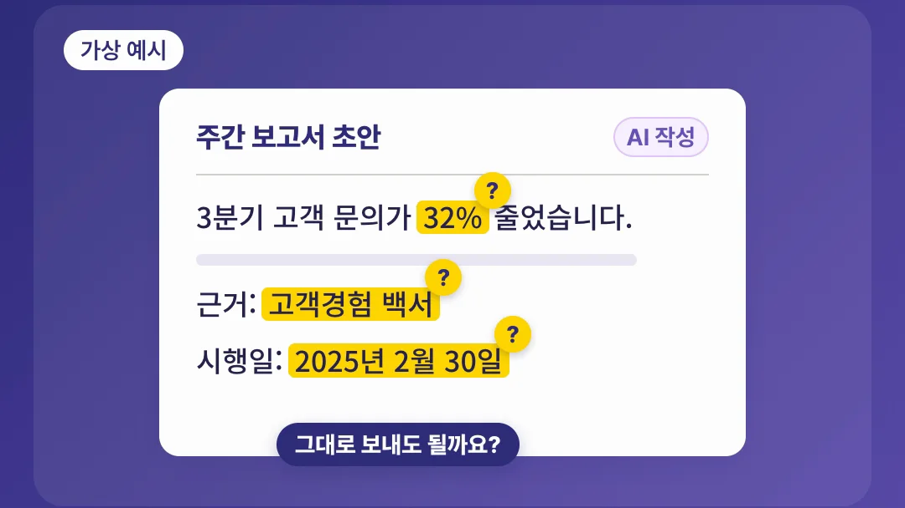
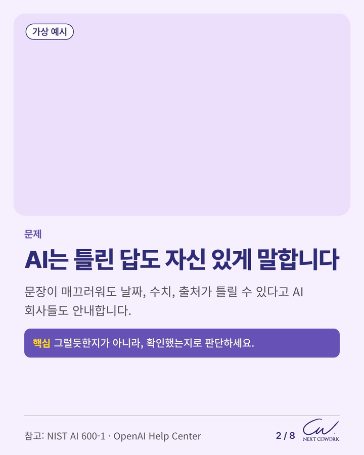
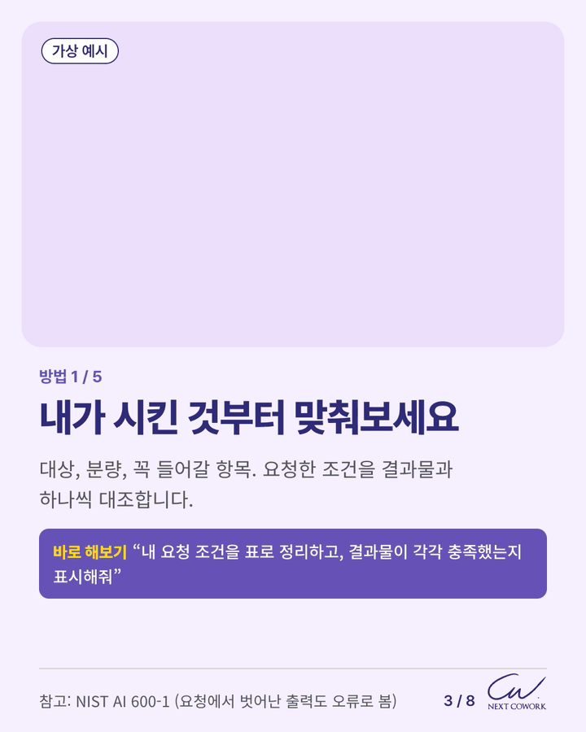
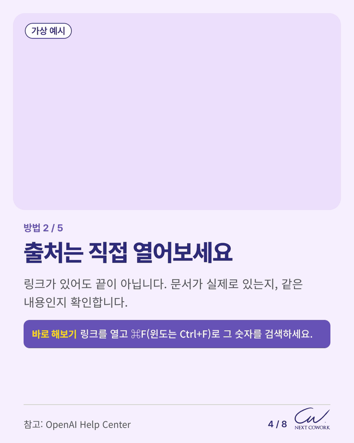
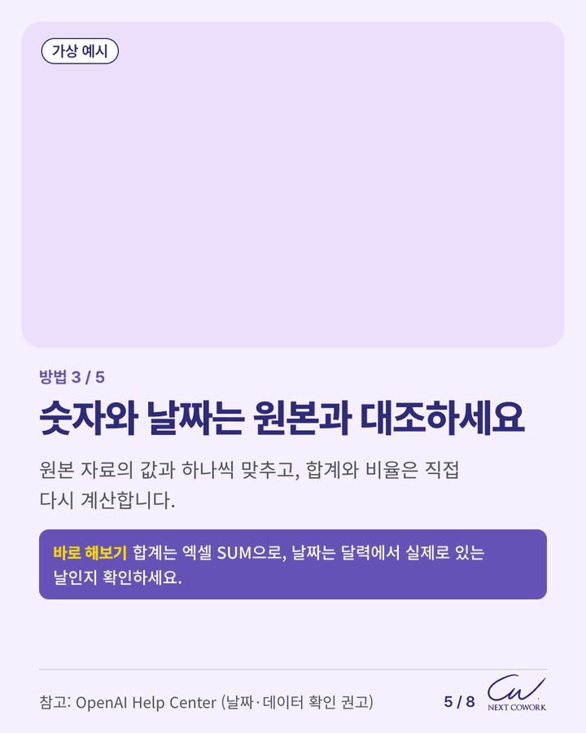
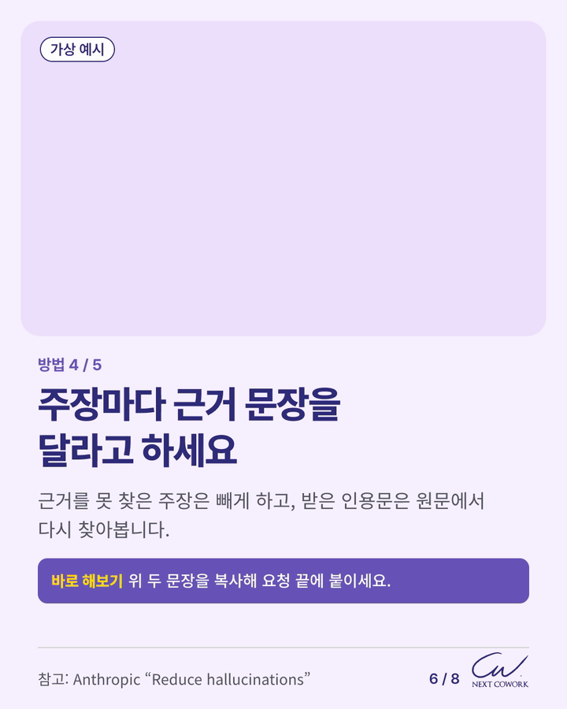
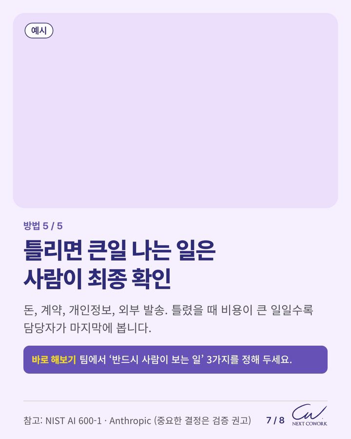

AI가 써준 보고서는 그럴듯할수록 그대로 보내고 싶어집니다. 하지만 문장이 매끄럽다고 내용이 맞는 것은 아닙니다. 이 글에서는 AI 결과물을 보내기 전에 확인할 5가지와 바로 붙여 쓸 수 있는 요청 문장, 저장해 두고 쓰는 체크리스트를 정리했습니다.



판단 기준은 하나입니다. **'그럴듯한가'가 아니라 '확인했는가'입니다.**

글 속 움직이는 화면은 이해를 돕기 위해 넥스트코웍이 만든 모션 카드이며, 대화·표·보고서·수치는 모두 가상 예시입니다.

## AI는 왜 틀린 답도 자신 있게 말하나요?

생성형 AI는 그럴듯한 다음 문장을 만들어 내는 방식으로 답합니다. 그래서 사실과 다른 내용도 확신에 찬 문장으로 나올 수 있습니다. 미국 국립표준기술연구소(NIST)는 생성형 AI 위험 관리 문서에서 이 현상을 '작화(confabulation)'로 분류하고, 잘못되거나 거짓인 내용을 자신 있게 제시하는 위험으로 설명합니다. 요청에서 벗어난 출력도 같은 범주에 넣었습니다. [1]

AI를 만드는 회사도 같은 점을 안내합니다. OpenAI는 ChatGPT가 틀린 날짜나 사실, 지어낸 인용과 출처를 내놓을 수 있으니 인용·데이터·참고자료를 확인하고 링크를 직접 열어 보라고 권합니다. [2]



문제는 AI의 실수 자체보다, 우리가 그 결과물을 확인 없이 다음 사람에게 넘기는 데 있습니다. 보고서가 결재선으로, 제안서가 고객에게 넘어간 뒤에 오류가 발견되면 수정 비용과 신뢰 손실은 보낸 사람이 감당합니다.

## 1. 내가 시킨 것부터 맞춰보세요

가장 먼저 볼 것은 사실 여부가 아니라 **요청과 결과물이 맞는지**입니다. 대상, 기간, 분량, 꼭 들어가야 할 항목을 요청문 옆에 두고 하나씩 대조합니다. 긴 답변일수록 요청한 항목 하나가 조용히 빠져 있는 경우가 많습니다.



AI에게 대조를 먼저 맡겨도 좋습니다. 다만 표시된 결과는 내가 다시 훑어봅니다.

```
내가 처음 요청한 조건을 표로 정리하고,
위 결과물이 조건마다 충족했는지 '충족 / 일부 / 누락'으로 표시해줘.
누락된 항목은 무엇이 빠졌는지 한 줄로 적어줘.
```

## 2. 출처는 직접 열어보세요

링크가 붙어 있다고 끝이 아닙니다. 그 문서가 실제로 있는지, 같은 내용이 적혀 있는지 직접 확인해야 합니다. 출처는 진짜인데 숫자나 맥락이 다르게 옮겨지는 경우도 있습니다.



가장 빠른 방법은 링크를 열고 ⌘F(윈도에서는 Ctrl+F)로 그 숫자나 핵심 단어를 검색하는 것입니다. 검색되지 않으면 그 문장은 근거가 없는 것으로 보고 다시 확인합니다.

## 3. 숫자와 날짜는 원본과 대조하세요

숫자는 원본 자료의 값과 하나씩 맞추고, 합계와 비율은 직접 다시 계산합니다. 날짜는 실제로 있는 날인지, 요일이 맞는지까지 봅니다. AI는 계산 과정 없이 결과 숫자만 그럴듯하게 적을 수 있습니다.



- **합계·비율:** 엑셀이나 스프레드시트의 SUM으로 다시 계산합니다.
- **날짜:** 달력에서 실제 날짜와 요일을 확인합니다.
- **단위:** 원·천 원·백만 원, %와 %p처럼 단위가 바뀌지 않았는지 봅니다.
- **기준 시점:** 숫자가 언제 기준인지, 원본과 같은 기간인지 확인합니다.

## 4. 주장마다 근거 문장을 달라고 하세요

AI에게 처음부터 근거를 붙이게 하면 확인할 범위가 줄어듭니다. Anthropic은 Claude 사용 안내에서 주장마다 근거가 되는 인용문을 붙이게 하고, 근거를 찾지 못한 주장은 철회하게 하는 방법을 소개합니다. 이 방법은 오류를 줄여 주지만 없애지는 못하므로, 중요한 정보는 여전히 검증하라고 덧붙입니다. [3] 같은 요청은 다른 AI 도구에도 그대로 써 볼 수 있습니다.



요청 끝에 아래 두 문장을 붙여 보세요.

```
각 주장마다 근거가 되는 원문 문장을 그대로 붙여줘.
근거를 못 찾으면 그 주장은 빼줘.
```

받은 인용문은 원문에서 꼭 다시 찾아보세요. 인용문 자체가 지어낸 문장일 수도 있기 때문입니다.

## 5. 틀리면 큰일 나는 것은 사람이 확인하세요

모든 결과물을 같은 강도로 검수할 필요는 없습니다. 대신 **틀렸을 때 되돌리기 어려운 일**은 반드시 담당자가 최종 확인합니다. NIST도 중대한 의사결정에 쓰일 때 이 위험을 특히 살펴야 한다고 적었습니다. [1]



예를 들어 다음과 같은 일입니다.

- 돈이 오가는 내용: 견적, 정산, 예산 수치
- 계약과 법적 효력이 있는 문서: 계약서, 합의서, 공문
- 개인정보가 포함된 자료
- 외부로 나가는 발송물: 고객 메일, 보도자료, 제안서

팀이라면 '반드시 사람이 보는 일' 세 가지를 미리 정해 두세요. 누가 무엇을 확인하는지 정해져 있어야 AI를 더 편하게 맡길 수 있습니다.

## 보내기 전 5가지 체크리스트

저장해 두고, AI 결과물을 보내기 전에 꺼내 보세요. 하나라도 '아니오'라면 그 부분만 다시 확인하면 됩니다.

- □ 요청한 조건을 다 채웠나요?
- □ 출처 링크를 직접 열어 봤나요?
- □ 숫자와 날짜를 원본과 맞췄나요?
- □ 주장마다 근거 문장이 있나요?
- □ 중요한 내용은 담당자가 확인했나요?

## 자주 묻는 질문

### 1. 유료 버전이나 최신 모델을 쓰면 검수하지 않아도 되나요?

그렇지 않습니다. 모델이 좋아질수록 오류는 줄 수 있지만, AI를 만드는 회사들도 중요한 정보는 확인하라고 안내합니다. [2] [3] 검수의 강도는 모델이 아니라 결과물이 어디에 쓰이는지로 정하는 것이 안전합니다.

### 2. 매번 5가지를 다 확인하기엔 시간이 부족합니다.

내부 메모나 아이디어 정리처럼 틀려도 쉽게 고칠 수 있는 결과물은 1번(요청 대조) 정도로 충분할 수 있습니다. 외부로 나가거나 숫자·계약이 걸린 결과물은 5가지를 모두 확인하세요. 결과물의 용도별로 확인 범위를 정해 두면 시간이 줄어듭니다.

### 3. 팀 전체가 같은 기준으로 검수하려면 어떻게 하나요?

체크리스트를 팀 공용 문서나 메신저 상단에 고정하고, '반드시 사람이 보는 일'과 담당자를 함께 적어 두는 것부터 시작하세요. 같은 업무 자료로 실습해 보면 기준이 빠르게 맞춰집니다.

## 우리 팀의 AI 검수 기준, 어떻게 정할까요?

AI를 업무에 쓰기 시작하면 "AI가 만든 결과물을 어디까지 믿어도 되나요?"라는 질문이 곧 따라옵니다. 도구 사용법보다 결과물을 확인하고 책임지는 기준이 먼저 서야 현업에서 AI를 계속 쓸 수 있습니다.

팀이 함께 실습하며 검수 기준을 세우고 싶으시다면 [AI Campus](/ai-campus/)에서 교육 범위와 구성을 살펴보세요. 우리 팀 업무에 맞는 시작점이 고민되시면 [문의로 현재 과제를 알려주세요](/contact/?s=ai-campus&t=diagnosis&cta=insight_ai_review). 함께 정리해 보겠습니다.

---
### 참고 자료

1. **NIST, 「AI 600-1 Artificial Intelligence Risk Management Framework: Generative Artificial Intelligence Profile」**, 2.2 Confabulation — [원문 PDF](https://nvlpubs.nist.gov/nistpubs/ai/NIST.AI.600-1.pdf)
2. **OpenAI Help Center, 「Does ChatGPT tell the truth?」** — [도움말 원문](https://help.openai.com/en/articles/8313428-does-chatgpt-tell-the-truth)
3. **Anthropic, 「Reduce hallucinations」** — [Claude 문서 원문](https://platform.claude.com/docs/en/test-and-evaluate/strengthen-guardrails/reduce-hallucinations)

글쓴이: 이종찬 · NextCowork 대표
